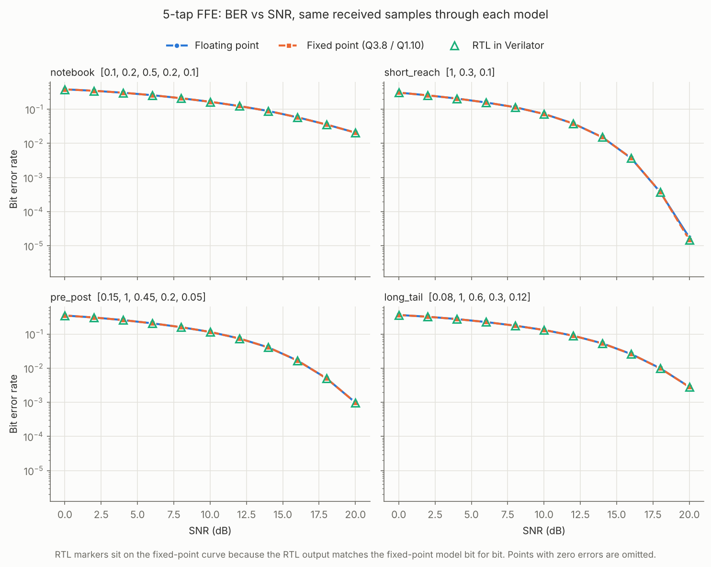

# Connecting the FFE Hardware to the PAM4 Link

This document covers two questions:

1. Does the hardware FFE behave the same as its floating-point and
   fixed-point models on real received PAM4 samples, and what does
   fixed-point arithmetic cost in BER?
2. Do the optimization results hold for coefficient sets derived from
   channels, without the paired structure of Cases A and C?

Reproduce everything with:

```bash
python3 python/channel/hardware_ber.py --symbols 200000   # BER, all channels
python3 python/channel/plot_ber.py                        # figure
python3 scripts/rebuild_all.py --seeds 10 --out results/channel/rebuild \
    --only notebook_baseline notebook_hand notebook_ai \
           short_reach_baseline short_reach_hand short_reach_ai \
           pre_post_baseline pre_post_hand pre_post_ai \
           long_tail_baseline long_tail_hand long_tail_ai
```

## 1. Setup

**Link model** (`python/channel/link.py`). Gray-coded PAM4 with the
benchmark notebooks' bit mapping, additive white Gaussian noise, and SNR
defined as received signal power over noise power, as in the notebooks.
The hardware FFE takes one sample per symbol, so each channel is a
symbol-spaced impulse response applied at the symbol rate.

| Channel | Impulse response | Character |
|---|---|---|
| `notebook` | [0.1, 0.2, 0.5, 0.2, 0.1] | The notebooks' channel taps, at symbol rate. Symmetric, strong ISI. |
| `short_reach` | [1.0, 0.3, 0.1] | Small trailing echo |
| `pre_post` | [0.15, 1.0, 0.45, 0.2, 0.05] | One pre-cursor, decaying post-cursors |
| `long_tail` | [0.08, 1.0, 0.6, 0.3, 0.12] | Long post-cursor tail, bandwidth-limited link |

**Coefficients** (`python/channel/equalizer.py`). For each channel, a
5-tap MMSE FFE is designed at 14 dB, with the decision delay chosen to
minimize MSE. The MMSE solution is rescaled to unit gain on the wanted
symbol, so that fixed PAM4 thresholds (0, ±2) apply. If any tap would
exceed 1.5, the equalizer target is scaled down so the taps fit in Q1.10
(range [−2, 2)), and the decision thresholds are scaled to match. Only
the `notebook` channel needs this (gain 0.562). Coefficients are then
rounded to Q1.10.

| Channel | Q1.10 coefficients (c0 = newest sample) | sum\|c\| | Saturation reachable |
|---|---|---|---|
| `notebook` | [−483, 1536, −398, −165, 106] | 2688 | Yes |
| `short_reach` | [13, 1020, −294, −13, 29] | 1369 | Yes |
| `pre_post` | [−134, 1152, −451, −31, 46] | 1814 | Yes |
| `long_tail` | [−41, 1097, −602, 29, 45] | 1814 | Yes |

None of these sets has the antisymmetric pairing of Cases A and C. That
pairing came from a symmetric channel; even the symmetric `notebook`
channel gives an unpaired set here, because the best decision delay is
not the channel's center. Every set has sum|c| > 1024, so saturation can
fire, unlike Cases B and C.

**Three models, same samples.** At each SNR from 0 to 20 dB (2 dB steps),
200,000 PAM4 symbols and one noise realization pass through:

- **Floating point:** unquantized samples and unquantized coefficients.
- **Fixed point:** samples rounded to Q3.8, Q1.10 coefficients,
  `sat12((c · x) >>> 10)`, bit-exact with the RTL specification.
- **RTL:** the Q3.8 samples driven into each RTL design in Verilator
  (`testbench/directed/ffe5tap_directed_tb.sv`, with a 2-cycle reset
  before each SNR block). The testbench dumps `y_out` every cycle, and BER
  is computed from those outputs.

## 2. Hardware vs. models

Every correct RTL design matches the fixed-point model on every cycle:
2,200,022 cycles per design per channel, 0 mismatches (baseline, hand and
optimized designs; the one exception is the failing `notebook` optimized
design, Section 4).



**Fixed point costs no measurable BER.** The floating-point and
fixed-point error counts differ by a few tens of errors at most, in both
directions, which is within the statistical noise of the measurement:

| Channel | SNR | Float errors | Fixed / RTL errors | BER |
|---|---|---|---|---|
| `notebook` | 14 dB | 35,643 | 35,628 | 8.9 × 10⁻² |
| `notebook` | 20 dB | 8,275 | 8,298 | 2.1 × 10⁻² |
| `short_reach` | 14 dB | 6,120 | 6,115 | 1.5 × 10⁻² |
| `short_reach` | 18 dB | 149 | 151 | 3.8 × 10⁻⁴ |
| `short_reach` | 20 dB | 7 | 6 | 1.5 × 10⁻⁵ |
| `pre_post` | 20 dB | 393 | 393 | 9.8 × 10⁻⁴ |
| `long_tail` | 20 dB | 1,131 | 1,127 | 2.8 × 10⁻³ |

Each point is 400,000 bits; full tables are in
`results/channel/<channel>/ber.csv`. Below about 10⁻⁵ these runs cannot
resolve a difference, so a quantization penalty at very low BER is not
ruled out.

**Input clipping.** At low SNR, noise occasionally pushes a received
sample beyond the Q3.8 range (±8). Those samples clip in the fixed-point
and RTL paths. The count per SNR point is recorded in `ber.csv`
(`input_samples_clipped`); it does not visibly affect BER.

**The `notebook` channel is too hard for a 5-tap linear FFE at symbol
rate.** Its echoes sum to more than its main tap (0.6 vs. 0.5), and the
best 5-tap equalizer still leaves about 9% of bits wrong at 14 dB and 2%
at 20 dB. This is consistent with the notebooks, where the DFE and neural
equalizers outperform the linear FFE. In the notebooks this channel is
applied to a 10-samples-per-symbol waveform, where it is much milder; the
symbol-rate version here is a harsher test.

## 3. Channel-derived coefficient sets through the hardware flow

Each set is implemented three ways:

- **Baseline:** the reference architecture (five multiplies, 28-bit
  accumulator, comparator saturation), generated by `python/rtl_gen/ffe_rtl.py`.
- **Hand CSD:** per-tap canonical-signed-digit shift-add, the same
  technique as the week 1 hand references (`rtl/hand/`).
- **Optimized:** Claude, given the Case B/C optimization prompt
  (Section 4).

All designs were run on the directed reset/saturation/extreme-input
tests and placed and routed over 10 seeds (`results/channel/rebuild/`).

| Channel | Design | Logic cells | LUT4 | Fmax median, MHz [range] | Directed tests |
|---|---|---|---|---|---|
| `short_reach` | Baseline | 778 | 698 | 18.2 [17.8, 18.8] | PASS |
| | Hand CSD | 498 | 430 | 23.8 [22.6, 24.7] | PASS |
| | Optimized | 206 | 185 | 55.5 [53.8, 59.6] | PASS |
| `pre_post` | Baseline | 682 | 606 | 18.9 [18.3, 19.8] | PASS |
| | Hand CSD | 493 | 425 | 24.7 [24.0, 25.4] | PASS |
| | Optimized | 216 | 198 | 66.5 [66.5, 66.5] | PASS |
| `long_tail` | Baseline | 979 | 900 | 17.2 [16.1, 17.4] | PASS |
| | Hand CSD | 614 | 547 | 23.5 [22.9, 25.2] | PASS |
| | Optimized | 249 | 227 | 64.5 [62.0, 65.3] | PASS |
| `notebook` | Baseline | 841 | 764 | 16.8 [16.4, 17.6] | PASS |
| | Hand CSD | 599 | 528 | 23.7 [22.7, 24.4] | PASS |
| | Optimized | 223 | 189 | 38.1 [35.2, 40.8] | **FAIL** |

Splitting the logic-cell saving, for the three correct optimized designs:

| Channel | Baseline → hand | Hand → optimized | Share of total saving beyond hand CSD |
|---|---|---|---|
| `short_reach` | −280 (−36%) | −292 (−59%) | 51% |
| `pre_post` | −189 (−28%) | −277 (−56%) | 59% |
| `long_tail` | −365 (−37%) | −365 (−59%) | 50% |

## 4. The optimized designs

**Protocol.** Same as Cases B and C: one attempt per set, no manual edits.
The prompt is `prompts/generalization/resource_optimization.txt` followed
by the baseline RTL, built by `python/channel/build_prompts.py` in exactly
the Case B/C format (the builder reproduces `case_B_prompt.txt` byte for
byte). Each prompt was sent to a fresh Claude instance with no other
project context, prefixed only with an instruction to answer directly
without using tools.

| | Recorded |
|---|---|
| Model | Claude (claude-opus-5-5) |
| Date | 2026-10-25 |
| Prompts | `prompts/channel/<channel>_prompt.txt` |
| Responses | `results/channel/<channel>/ai_response.md` (verbatim) |
| RTL | `rtl/channel/optimized/ffe5tap_<channel>_optimized.sv`, identical to the response code apart from a provenance header comment |
| Iterations | 1 |
| Manual edits | None |

**What the optimized designs do.** All four independently use the same
architecture, which none of the Case A–C designs used:

- **Transposed form.** Instead of delaying the input (`x1`..`x4`), the
  registers hold running partial sums. Every multiply then acts on the
  current input only.
- **Shared constant multiplication.** Because all products use the same
  input, sub-products are shared across taps. For example, `long_tail`
  builds 41x, 45x, 29x, 301x and 1097x from a shared 33x with 6 adders,
  where per-tap CSD needs 14.
- **Free flip-flops.** On the iCE40 a flip-flop shares a logic cell with
  the LUT that feeds it. Delay-line flip-flops have no LUT and cost a cell
  each; transposed-form registers are fed by adders and pack for free.
- **Trailing-zero pass-through and exact widths**, as in Case C.
- **Saturation as a 2-bit overflow test** instead of two 28-bit
  comparators.

The transposed form also shortens the critical path, which is why Fmax
rises to 55–67 MHz, against 17–19 MHz for the baselines and about 24 MHz
for hand CSD.

**The `notebook` design is wrong.** Its arithmetic is correct; the
accumulator holds the exact sum. The overflow test is not. The output
fits 12 bits exactly when `acc[23:21]` are all equal, but the design
tests `acc[23:11]`, so any output with magnitude 2 or more is forced to
a rail. The response states the design is bit-exact, without having
simulated it. The directed tests catch it immediately (3,898 of 5,693
cycles wrong), and on the channel it gives BER 0.28 at 14 dB instead of
0.089. Following the protocol, it is reported as a failure and not
fixed.

**Self-estimates vs. measured.** Each response estimated its own logic
cells by hand. Measured counts were 4–31% higher than those estimates: `short_reach` ~170 vs.
206, `pre_post` 185–200 vs. 216, `long_tail` 190–210 vs. 249,
`notebook` ~215 vs. 223.

## 5. Interpretation

- **The hardware is correct on real signals.** Bit-exact agreement over
  8.8 million cycles of channel data per design type, plus zero BER loss
  from 12-bit fixed point at the BER levels measured.
- **The optimization gains hold without paired coefficients.** On
  channel-derived sets the optimized designs are 2.3–2.5× smaller than
  hand CSD and 2.3–2.7× faster, a larger margin than in Cases A–C.
- **One in four optimized designs was wrong.** The failure was a
  plausible-looking bit-range error that a careful reader could miss;
  only simulation found it. Any automated flow built on these designs
  needs a verification gate, which is part of the plan for the
  optimization loop.
- **Fairness of the hand reference.** The hand reference is direct-form
  CSD. Transposed form is a standard textbook technique, and a hand
  transposed-form CSD design would narrow the gap. That comparison has
  not been run. The result here is that the optimized designs applied it
  unprompted.
- **Scope.** Four channels, one FPGA family, one synthesis flow, 5 taps.
